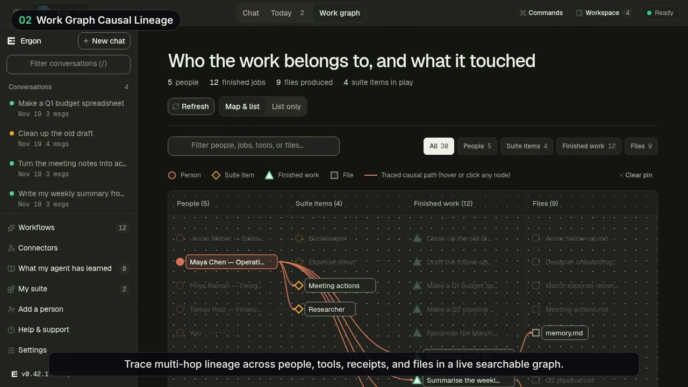

<div align="center">

<p>
  <picture>
    <source media="(prefers-color-scheme: dark)" srcset="docs/brand/ergon-logo-dark.svg" />
    
  </picture>
</p>

**A personal AI agent for every employee, self-hosted by your company in one binary.**

Every employee talks to their agent in plain English while it finishes digital work in real time, recognizes and connects their apps, builds reusable tools around repeat tasks, and asks for a tap on `/phone` before risky actions.

[](https://github.com/cayleb-james2008/ergon/actions/workflows/ci.yml)
[](https://github.com/cayleb-james2008/ergon/releases)
[](LICENSE)

[](https://cayleb-james2008.github.io/ergon/)

</div>

---

<p align="center">
  <picture>
    <source media="(prefers-color-scheme: dark)" srcset="docs/screenshots/hero-dark.png" />
    
  </picture>
  &nbsp;
  <picture>
    <source media="(prefers-color-scheme: dark)" srcset="docs/screenshots/phone-dark.png" />
    
  </picture>
</p>

<p align="center">
  <a href="https://github.com/cayleb-james2008/ergon/releases/download/v0.42.1/ergon-walkthrough.mp4">
    
  </a><br />
  <sub><a href="https://github.com/cayleb-james2008/ergon/releases/download/v0.42.1/ergon-walkthrough.mp4">Watch the 48-second walkthrough (1280×720 H.264 MP4)</a> · <a href="https://github.com/cayleb-james2008/ergon/releases/download/v0.42.1/ergon-walkthrough-chapters.vtt">Chapter markers (VTT)</a></sub>
</p>

## Why Ergon

Most AI tools ask non-technical staff to learn prompting, copy data between tabs, or stitch integrations together themselves. Ergon gives every employee an isolated personal agent shaped around the work they already do. In default **Simple mode**, using it feels like talking to your computer: type what you need in plain English, watch each step finish live on screen, and review the resulting spreadsheets, documents, or briefs. Power users can switch to **Advanced mode** in one click for multi-branch DAG workflows, Work Graph views, schedules, and custom connectors.

Ergon also spots which apps a person uses across their workspace files and conversations and suggests 1-click setups from an auto-updating 32-app library (Google Workspace, Microsoft 365 & Outlook, Slack, Notion, Linear, Jira, GitHub, Figma, HubSpot, Stripe, QuickBooks, plus live Official MCP Registry search) with browser OAuth2 (PKCE `S256`) or encrypted API keys. When an employee repeats a task, their agent writes and sandbox-tests a reusable tool and sends a `"Would this help?"` card to install it for themselves or share with the company library. Deletions, outbound emails and webhooks, retainer budget caps, MCP writes, and new tool installs always pause for an Approve/Deny tap on `/phone` or desktop.

The entire server compiles into one `12.11 MiB` static Rust binary (or a multi-arch `linux/amd64` and `linux/arm64` container) with no Postgres, Redis, or separate worker cluster to maintain. Deploying on an office mini-PC or small VPS through **Coolify** ([`docker-compose.coolify.yml`](docker-compose.coolify.yml)) gives your team automatic HTTPS, mobile `/phone` access, and `/data` volume backups, leaving model usage as the main ongoing cost: default **OpenCode Go** (`$20`/employee plans on `deepseek-v4.1-flash`, either as a shared key or per-employee encrypted personal seat keys), or Anthropic Claude, OpenAI, and local Ollama.

---

## Key Capabilities

<table>
  <tr>
    <td width="50%">
      <strong>Shared Company DB, Memory &amp; Work Graph</strong><br />
      Per-employee isolated workspaces plus visibility-scoped company memory (<code>company</code>, <code>role:*</code>, <code>client:*</code>) and interactive team graph.<br /><br />
      <picture>
        <source media="(prefers-color-scheme: dark)" srcset="docs/screenshots/worktree-lanes-dark.png" />
        
      </picture>
    </td>
    <td width="50%">
      <strong>Tool Builder, Self-Improvement &amp; MCP / Mail</strong><br />
      Agents build and test sandboxed tools, gate new versions on historical case replay (with auto-rollback), and talk to MCP, SMTP/IMAP, and HMAC webhooks.<br /><br />
      <picture>
        <source media="(prefers-color-scheme: dark)" srcset="docs/screenshots/protocols-mcp-c4e2-dark.png" />
        
      </picture>
    </td>
  </tr>
  <tr>
    <td width="50%">
      <strong>Strict Client Vaults, Citations &amp; Audit Handoff</strong><br />
      Every claim is checked against workspace line ranges (<code>[file:L##]</code>). <code>Strict Client</code> blocks handoff exports on leaks or stale citations with <code>HTTP 409</code>.<br /><br />
      <picture>
        <source media="(prefers-color-scheme: dark)" srcset="docs/screenshots/run-diff-dark.png" />
        
      </picture>
    </td>
    <td width="50%">
      <strong>Retainer Metering, Rollups &amp; Offline Verify</strong><br />
      Live token spend, PDF/DOCX/XLSX generation, penny-exact <code>i128</code> table rollups, and offline bundle verification via <code>ergon verify</code>.<br /><br />
      <picture>
        <source media="(prefers-color-scheme: dark)" srcset="docs/screenshots/clients-metering-dark.png" />
        
      </picture>
    </td>
  </tr>
</table>

---

## Quick Start

### 1. Self-Host with Coolify (Recommended for Teams)

Deploy [`docker-compose.coolify.yml`](docker-compose.coolify.yml) (`ghcr.io/cayleb-james2008/ergon:latest`) in Coolify for automatic HTTPS, `/phone` approvals, persistent `/data` storage, and **OpenCode Go** (`https://opencode.ai/zen/go/v1`, `deepseek-v4.1-flash`) with either a shared company key or per-employee seat keys in **Settings → Model connection**. Full setup walkthrough: [`docs/COOLIFY.md`](docs/COOLIFY.md).

### 2. Single Binary or Build from Source

Download an archive for **Linux (`x86_64` / `aarch64`)** or **Windows (`x86_64`)** from [Releases](https://github.com/cayleb-james2008/ergon/releases), or build from source (`Rust` + `Node.js 20+`):

```sh
# Build from source (Linux / Windows)
cd frontend && npm ci && npm run build && cd ..
cargo build --release --locked

# Run with OpenCode Go (deepseek-v4.1-flash default)
ERGON_MODEL_API_KEY=... ./target/release/ergon

# Or Anthropic Claude (native /v1/messages + prompt caching) / OpenAI / local Ollama
ANTHROPIC_API_KEY=sk-ant-... ./target/release/ergon
```

### 3. Live Browser Demo

Try workflows directly in your browser with zero install on the [GitHub Pages Live Demo](https://cayleb-james2008.github.io/ergon/) (runs the standalone offline engine over IndexedDB).

---

## Reproducible Benchmarks & Security Evals

All claims below are backed by [`evals/run_evals.py`](evals/run_evals.py) against the compiled `v0.42.1` release binary ([`evals/results/report.md`](evals/results/report.md)) and live timing runs ([`evidence/timing/2026-11-27/`](evidence/timing/2026-11-27/README.md)):

| Evaluation | Mode | Baseline (Raw LLM) | Ergon (`v0.42.1`) | Outcome |
| --- | --- | --- | --- | --- |
| **1. 200-Row Messy Ledger Reconciliation** | `live_llm` (`claude-haiku-5-5`) | Exact (`18.69s`) | Exact **`$50,070.68`**, 4 dups flagged, `15` `[file:L##]` citations (`6.68s`, **2.8× faster**) | **PASS** |
| **2. 50-SKU Messy BOM Quote Builder** | `live_llm` (`claude-haiku-5-5`) | `47` SKUs, exact (`12.38s`) | **`47`** unique SKUs, exact **`$55,035.70`**, formula-escaped (`2.27s`, **5.5× faster**) | **PASS** |
| **3. Security & Prompt-Injection Probes** | `live_llm` + `deterministic` | — | **`8/8`** blocked (live injection, traversal, symlink, SSRF, secret write) | **PASS** |
| **4. Strict Client Leak Gate & Receipt Verify** | `deterministic` | — | **`HTTP 409`** on leak, **`HTTP 200`** clean ZIP, offline `ergon verify` valid | **PASS** |
| **5. Multi-Tenant RBAC & Memory Isolation** | `deterministic` | — | Role/workspace isolation enforced; unauthorized writes blocked (`403`) | **PASS** |
| **6. Replay-Gated Self-Improvement** | `deterministic` | — | `v2` promoted on replay (`0` regressions), `v3` rejected, live auto-rollback -> `v1` | **PASS** |

- **Server footprint (`v0.47.0` Linux release):** `12.11 MiB` single binary (`12,694,384 B`); `v0.40.0` measured `6.08 ms` cold boot, `22.19 MB` peak RSS, and `4,009.2 req/s` (`0/10,036` errors) over 16 concurrent workers.
- **Sequential live model timing study (`30` runs across 4 roles):** [`evidence/timing/2026-11-27/report.md`](evidence/timing/2026-11-27/report.md).

---

## Architecture & Security

Ergon separates probabilistic LLM routing from deterministic computation (`i128` cent arithmetic, 16-hop symlink confinement, SHA-256 receipt chains, and AES-256-GCM secret storage):

```text
  Desk (/) & Phone (/phone) ──► Raw TcpListener / rustls TLS (src/server/, src/auth.rs)
                                   │
        ┌──────────────────────────┼──────────────────────────┐
        ▼                          ▼                          ▼
  Agent Loop & Clients       DAG & Routine Engine      Company & Safety Core
  src/lib.rs, src/llm.rs     src/pipelines/,           src/company_db.rs, src/tool_builder.rs,
  (OpenCode Go, Claude       src/scheduler.rs          src/self_improve.rs, src/tripwire.rs,
   /v1/messages, OpenAI)     (4-way DAG, crash resume) src/receipts.rs, src/secret_store.rs
```

- **Deep dives:** [`docs/COOLIFY.md`](docs/COOLIFY.md) · [`ARCHITECTURE.md`](ARCHITECTURE.md) · [`SECURITY.md`](SECURITY.md) · [`docs/BACKEND_API.md`](docs/BACKEND_API.md) · [`evals/README.md`](evals/README.md) · [`CLAIMS.md`](CLAIMS.md) · [`MVP.md`](MVP.md) · [`CHANGELOG.md`](CHANGELOG.md)

## License

Released under the [MIT License](LICENSE).
