# Ergon

[](https://github.com/cayleb-james2008/ergon/actions)
[](https://github.com/cayleb-james2008/ergon/releases)
[](LICENSE)
[](#architecture)

<p align="center">
  <picture>
    <source media="(prefers-color-scheme: dark)" srcset="docs/screenshots/hero-dark.png" />
    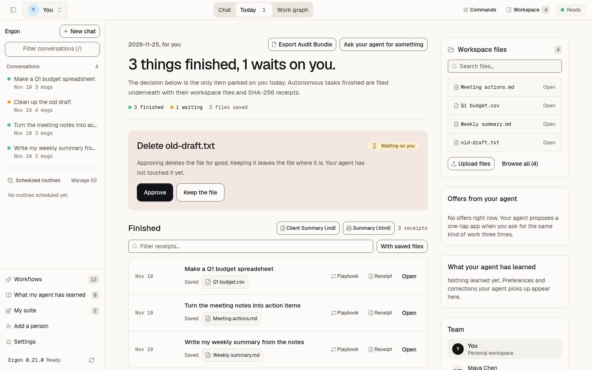
  </picture>
</p>

Ergon is a local agent desk and company workforce server. Employees describe tasks in plain words, and their personal agent works inside an isolated per-person workspace using built-in workflows, verifies citations against exact line numbers (`[file:L##]`), and records each finished run as a SHA-256 chained Field-Book receipt.

Across a company, one Rust binary serves the React web UI (`/` and `/phone`), raw-TCP HTTP and SSE engine, sandboxed document readers and exporters, standing memory (`memory.md`), routine scheduler, shared company database and memory, proactive tool builder, replay-gated self-improvement loop, and scoped backend APIs, webhooks, and MCP without an external database or runtime. See [CLAIMS.md](CLAIMS.md) for the full verification ledger and [docs/BACKEND_API.md](docs/BACKEND_API.md) for external API details.

---

## Feature gallery

<table>
  <tr>
    <td width="50%">
      Compare any two finished receipts or <code>.history/</code> snapshots side by side, switch workspace audit policy profiles in one click, and append a signed <code>## Verified Run Delta</code> section into a Client Pack.
      <br /><br />
      <picture>
        <source media="(prefers-color-scheme: dark)" srcset="docs/screenshots/run-diff-dark.png" />
        
      </picture>
    </td>
    <td width="50%">
      Inspect a deterministic SVG provenance graph connecting people, playbooks, finished receipts, and workspace deliverables, or toggle back to a plain list view.
      <br /><br />
      <picture>
        <source media="(prefers-color-scheme: dark)" srcset="docs/screenshots/worktree-lanes-dark.png" />
        
      </picture>
    </td>
  </tr>
  <tr>
    <td width="50%">
      Run resumable hybrid pipelines combining deterministic local skills, AI agent steps, structured human checkpoints, and document exports with restart persistence (<code>/api/pipelines/*</code>) and offline browser parity.
      <br /><br />
      <picture>
        <source media="(prefers-color-scheme: dark)" srcset="docs/screenshots/pipelines-dark.png" />
        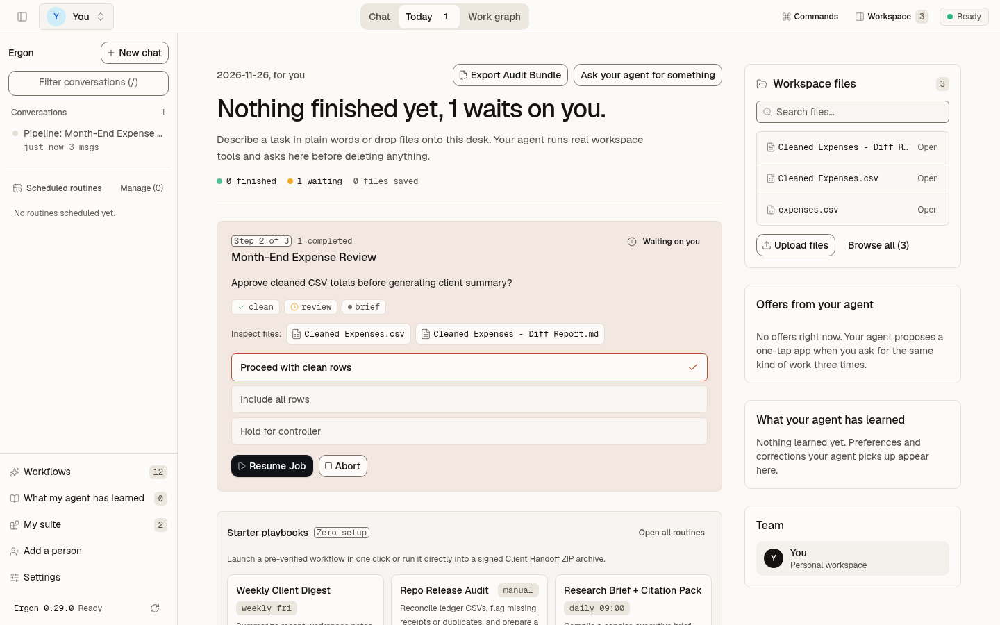
      </picture>
    </td>
    <td width="50%">
      Edit Markdown deliverables or CSV tables inline with <code>.history/</code> revision safety, run fixed-point <code>POST /api/tables/query</code> group-by rollups across CSV/XLSX/JSON files, and export native PDF 1.4 reports or multi-sheet formula <code>.xlsx</code> workbooks.
      <br /><br />
      <picture>
        <source media="(prefers-color-scheme: dark)" srcset="docs/screenshots/studio-editor-dark.png" />
        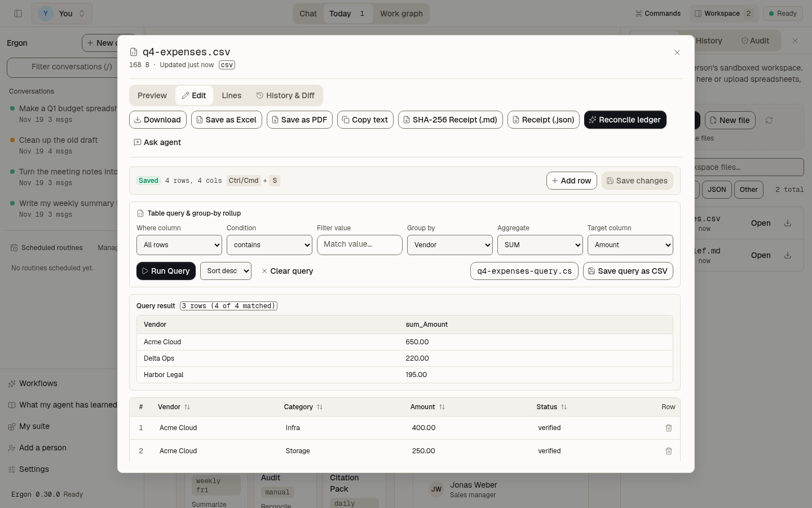
      </picture>
    </td>
  </tr>
  <tr>
    <td width="50%">
      Accept signed inbound webhooks (<code>POST /api/hooks/:hook_id</code>) and local watched folders into routines, encrypt credentials inside <code>secrets.enc.json</code>, and gate outbound HTTP deliveries through Today approval cards and workspace policies.
      <br /><br />
      <picture>
        <source media="(prefers-color-scheme: dark)" srcset="docs/screenshots/connectors-dark.png" />
        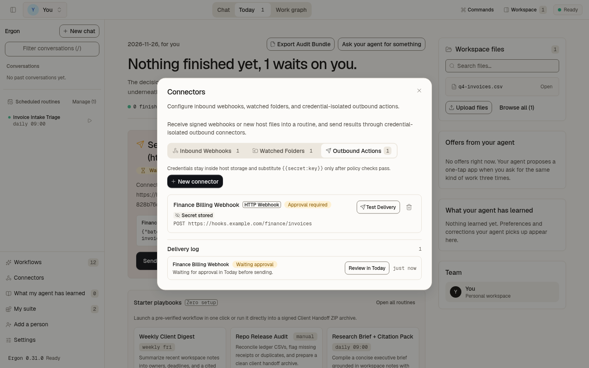
      </picture>
    </td>
    <td width="50%">
      Group work under client engagements and retainers, track LLM token spend, time saved, and billable ROI in Today, configure per-model token rates in Settings, and pause spend at retainer budget gates until approved.
      <br /><br />
      <picture>
        <source media="(prefers-color-scheme: dark)" srcset="docs/screenshots/clients-metering-dark.png" />
        
      </picture>
    </td>
  </tr>
  <tr>
    <td width="50%">
      Search every line, PDF page, and Excel sheet past the first 512 characters with hybrid BM25 and vector ranking, jump straight to highlighted source lines, and run exact-decimal multi-file CSV, TSV, and workbook rollups (<code>GET /api/search</code>, <code>POST /api/vault/reindex</code>, <code>POST /api/vault/aggregate</code>).
      <br /><br />
      <picture>
        <source media="(prefers-color-scheme: dark)" srcset="docs/screenshots/vault-search-dark.png" />
        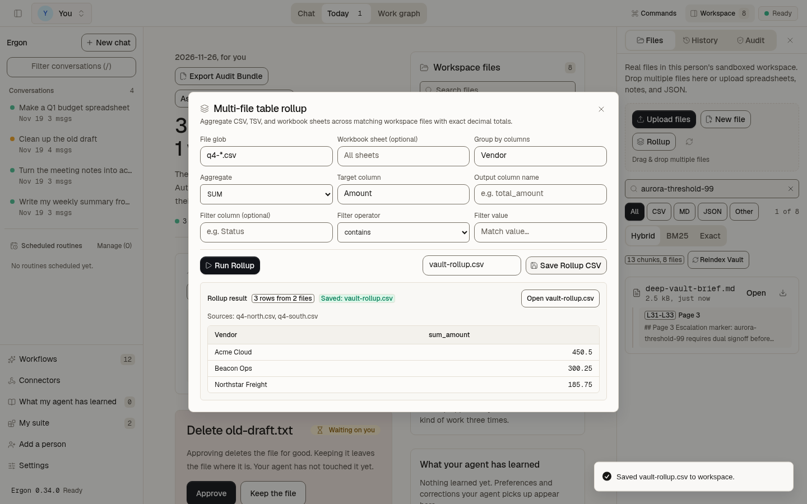
      </picture>
    </td>
    <td width="50%">
      Build parallel DAG pipelines with <code>depends_on</code> branches, <code>for_each</code> batch fan-out, conditional <code>on_all_ok</code> and <code>expr:</code> gates, policy-held <code>deliver</code> steps, <code>POST /api/pipelines/validate</code> cycle checking, and live <code>token_delta</code> SSE streaming.
      <br /><br />
      <picture>
        <source media="(prefers-color-scheme: dark)" srcset="docs/screenshots/dag-pipelines-dark.png" />
        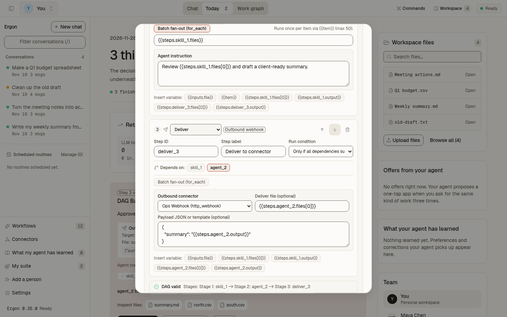
      </picture>
    </td>
  </tr>
  <tr>
    <td width="50%">
      Isolate client vaults by engagement prefix with strict cross-client leak blocking (<code>HTTP 409</code>), manage client contacts, tax rates, SOW rules, and rollover retainers in the CRM drawer, log billable time and expenses, and generate PDF, XLSX, and JSON invoices straight from Today.
      <br /><br />
      <picture>
        <source media="(prefers-color-scheme: dark)" srcset="docs/screenshots/client-vaults-invoicing-c4e1-dark.png" />
        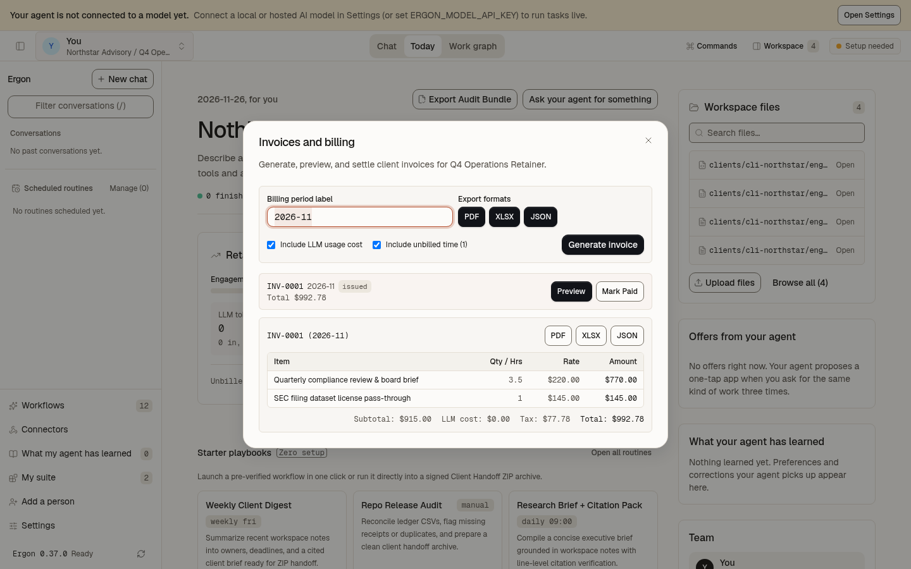
      </picture>
    </td>
    <td width="50%">
      Deliver signed MIME emails over SMTPS or STARTTLS with OAuth2 token refresh, ingest IMAP mailboxes into <code>workspace/intake/</code>, register stdio and HTTP/SSE MCP servers (<code>/api/mcp/servers</code>), and settle <code>mcp_tool_call</code> approvals in Today.
      <br /><br />
      <picture>
        <source media="(prefers-color-scheme: dark)" srcset="docs/screenshots/protocols-mcp-c4e2-dark.png" />
        
      </picture>
    </td>
  </tr>
  <tr>
    <td width="50%">
      Run concurrent chat and scheduled pipeline runs side by side in <code>LiveRunTimeline</code> with per-run Stop controls, pause and resume parallel DAG branch checkpoints individually (<code>pending_checkpoints[]</code>), configure step timeouts, retries, error jumps, and nested subpipelines, and schedule 5-field Cron jobs with explicit timezones.
      <br /><br />
      <picture>
        <source media="(prefers-color-scheme: dark)" srcset="docs/screenshots/dag-scheduler-c4e3-dark.png" />
        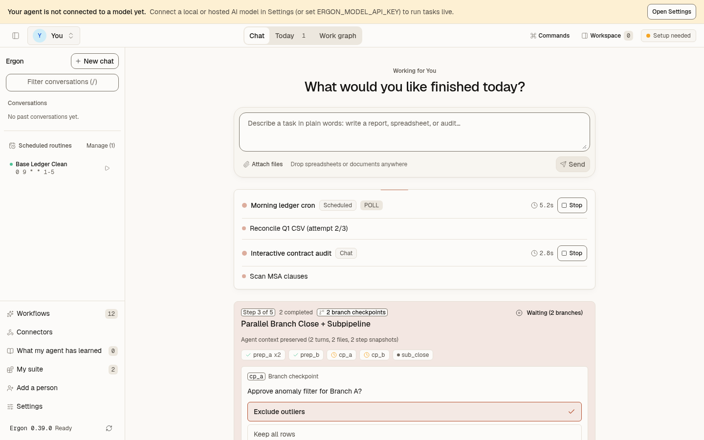
      </picture>
    </td>
    <td width="50%">
      Compose 5-field Cron schedules with timezone offsets, offline deterministic badges, per-step timeout, retry, backoff, and <code>on_error</code> policies, and nested subpipeline steps inside Routines and Pipeline Builder without horizontal overflow across desktop and mobile viewports.
      <br /><br />
      <picture>
        <source media="(prefers-color-scheme: dark)" srcset="docs/screenshots/dag-scheduler-c4e3-390-dark.png" />
        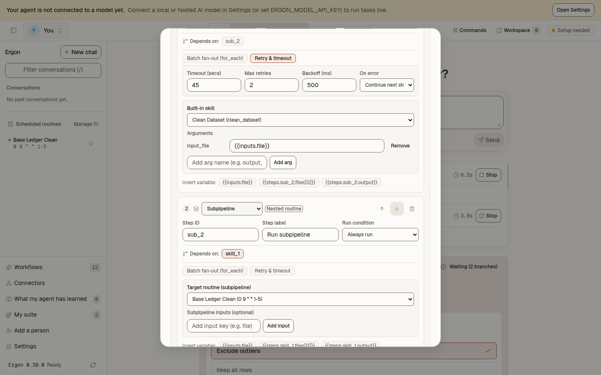
      </picture>
    </td>
  </tr>
  <tr>
    <td width="50%">
      Hardened dialogs keep sticky headers and Close or Save controls pinned across desktop and <code>390x844</code> mobile viewports with zero horizontal overflow, while live SSE streams reconcile concurrent runs cleanly with inline retry recovery.
      <br /><br />
      <picture>
        <source media="(prefers-color-scheme: dark)" srcset="docs/screenshots/hardening-c4h1-dark.png" />
        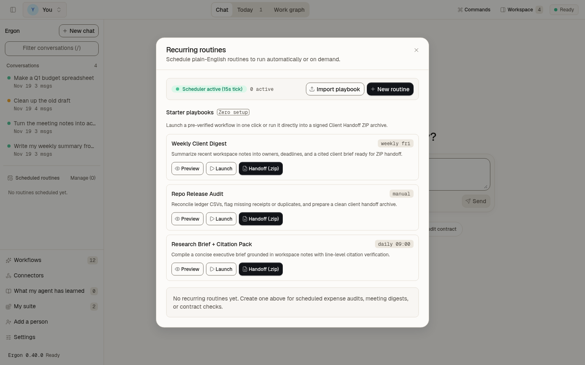
      </picture>
    </td>
    <td width="50%">
      Mobile Connectors, Client CRM, and Pipeline Builder modals wrap long URLs, Cron expressions, and MCP stdio commands cleanly inside <code>390x844</code> Light and Dark sheets without horizontal scroll.
      <br /><br />
      <picture>
        <source media="(prefers-color-scheme: dark)" srcset="docs/screenshots/hardening-c4h1-390-dark.png" />
        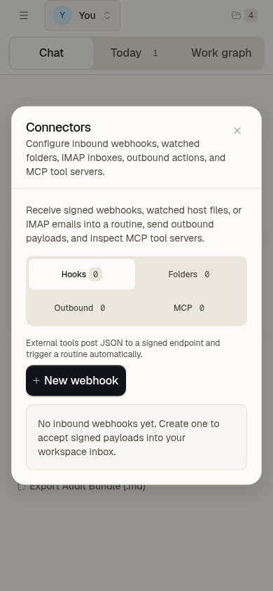
      </picture>
    </td>
  </tr>
</table>

---

## Architecture

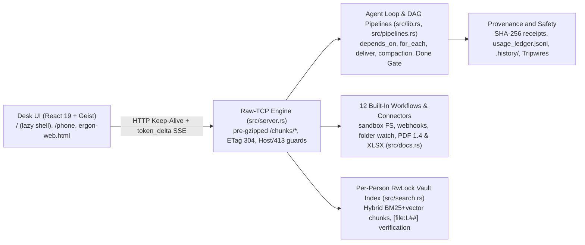

---

## Verified benchmarks (`v0.40.0` vs `v0.11.0`)

Measured against the stripped fat-LTO release binary on local loopback against a `5,000` receipts and `500` workspace files dataset:

| Metric | `v0.11.0` baseline | `v0.40.0` measured | Change |
| --- | --- | --- | --- |
| Release binary size | `16.0 MB` | `8.83 MiB` (`9,257,832 B`) | `-44.8%` |
| Initial `/` shell payload | `1.15 MB` | `179.72 KiB` (`184,037 B`) raw / `41.31 KiB` (`42,306 B`) gzip (`17` `/chunks/*`) | `-96.5%` wire |
| Cold boot to `200 OK` | `n/a` | `6.08 ms` | `6.1 ms` self-audit |
| Peak RSS (`VmHWM`, `5k` receipts + `500` files, `5/5` SSE, `16w`) | `n/a` | `22.19 MB` (`22,724 KB`) | `22.19 MB` peak RSS |
| Concurrent HTTP (`16w` mixed 5 routes + `5/5` SSE across `5k`/`500`) | `724 req/s` (`188.7 ms` p95) | `4,009.2 req/s` (`3.84 ms` p50, `8.62 ms` p95, `0/10,036` err) | `5.54x` under full concurrency |
| Automated checks | `204` Rust tests | `303/303` Rust tests (`7/7` `hardening_c4h1`), `118/118` gate, `6/6` graph, `20/20` replay, `44/44` fuzz, `0/0/0` `sloplint` | Zero warnings / zero externals |

`v0.41.0` automated checks pass `394/394` serial Rust tests across `36` non-zero suites, `clippy --locked --all-targets -- -D warnings` with 0 warnings, `cargo xwin check --locked --target x86_64-pc-windows-msvc --lib --bins` with 0 errors, and `npm run check:ui -- --skip-build --lints` (`gate 124/124`, `graph 6/6`, `replay 20/20`, `sloplint 0/0/0` rendered).

---

## Quick start

### 1. Build from source

```sh
git clone https://github.com/cayleb-james2008/ergon.git
cd ergon
cd frontend && npm ci && npm run build && cd ..
CARGO_BUILD_JOBS=2 cargo build --release --locked
```

### 2. Launch locally

```sh
./target/release/ergon             # opens a desktop window on http://127.0.0.1:8787
./target/release/ergon --no-open   # runs in headless server mode
./target/release/ergon verify ergon-audit-bundle.json --workspace ./data/workspace
./target/release/ergon export-handoff --out ergon-client-handoff.zip
```

To install a managed local launcher (`ergon-serve`) with an optional `systemd --user` service:

```sh
./install.sh [--prefix DIR] [--data DIR] [--no-service]
```

### 3. Connect a model

On startup, unless `ERGON_NO_AUTO_MODEL=1` or an explicit `ERGON_MODEL_BASE_URL`, `ERGON_MODEL_API_KEY`, or `data/config.json` is set, Ergon probes OpenAI-compatible gateways on loopback (`127.0.0.1:11434/v1`, `:8790/v1`, `:8789/v1`). You can switch providers or enter a remote endpoint and key inside Settings (`GET` and `POST /api/config`). Without a reachable gateway or key, `/api/chat` returns `HTTP 503` instead of making up a response.

---

## Configuration (`env`)

| Variable | Default |
| --- | --- |
| `ERGON_HOST` / `ERGON_PORT` | `127.0.0.1` / `8787` |
| `ERGON_ALLOWED_HOSTS` | unset (comma-separated extra hosts accepted without a gate token; loopback is always accepted) |
| `ERGON_DATA_DIR` | `./data` (people, threads, `config.json`, per-person workspaces) |
| `ERGON_WORKSPACE` | `<data>/workspace` (default person sandbox root) |
| `ERGON_MODEL_BASE_URL` | auto-probed local gateway (`:11434`, `:8790`, or `:8789`), or `https://opencode.ai/zen/go/v1` |
| `ERGON_MODEL_ID` | auto-detected gateway default, or `deepseek-v4.1-flash` |
| `ERGON_MODEL_API_KEY` | unset (optional on loopback; required for remote endpoints) |
| `ERGON_NO_AUTO_MODEL` | `0` (`1` disables local gateway probing on startup) |
| `ERGON_NO_OPEN` / `ERGON_OPEN` | `0` (`ERGON_NO_OPEN=1` or `--no-open` disables window launch; `--app` forces it) |
| `ERGON_GATE_TOKEN` | unset (when set, every request must send a matching `X-Ergon-Gate` header) |
| `ERGON_FETCH_ALLOW_PRIVATE` | `0` (`1` lets the agent fetch loopback or private-network URLs without asking) |
| `ERGON_FETCH_ALLOW_HOSTS` | unset (comma-separated private hosts the agent may always fetch) |
| `ERGON_TRIPWIRE_NO_BAN` | `0` (`1` logs scanner trips without banning the source IP) |
| `ERGON_TRUST_PROXY` | `0` (`1` trusts the right-most `X-Forwarded-For` entry behind a local reverse proxy) |

---

## Company workforce layer

### Personal agent and quality bar

Each employee has an isolated personal agent with a private workspace, threads, `memory.md`, `work.json` log, and `suite.json` of installed skills, subagents, and apps. Standing preferences from `memory.md` inject into subsequent runs, and `quality_bars.json` tracks per-task quality bars across repeated task families. Employees steer output on Today or `/phone` with **Improve** and **Good enough** actions: **Improve** feeds prior scores and criteria back as beat-last-run guidance, while **Good enough** locks the accepted recipe so later runs stay steady without drifting.

### `/phone` decision cards and push alerts

`GET /phone` serves a mobile web face over the same HTTPS, login, and RBAC layer. Routine tasks execute autonomously, while consequential actions (`delete_file`, `flag_decision`, `connector_delivery`, `mcp_tool_call`, `budget_gate`, and `tool_offer`) park as concise Approve or Deny cards. Live `push_notification` SSE frames, the notification bell, and registered push subscriptions alert employees on their phones as soon as a decision or offer needs attention.

### Proactive offers ("Would this help?") and sandboxed tool builder

Ergon inspects each employee's `work.json` log and cross-team company library (`POST /api/offers/analyze` and `GET /api/offers`) to spot repeated manual tasks or helpful tools built by teammates. When a new capability fits, the agent synthesizes a sandboxed workflow script and automated fixture tests (`src/tool_builder.rs`, `/api/tools/test`, `/api/tools/build`), runs the test suite in an isolated scratch sandbox, and sends a `"Would this help?"` card to `/phone`. Approving the card installs the verified tool into the employee's `suite.json` and publishes it with version, author, and test evidence to the shared company library, where other employees can install and run it in their own workspaces.

### Self-improvement loop

Skills, subagents, tools, and improvers keep version history (`versions.json`) scored by live outcomes in `outcomes.jsonl` (approvals, denials, deliverable edits, reruns, and time saved). Before any candidate revision ships, `POST /api/evolution/propose` replays both the active champion and the candidate against recorded historical cases (`replay_cases.json`) inside scratch sandboxes and promotes only when the candidate passes with zero regressions and beats the baseline by more than `0.01`. If a promoted version drops in live quality or exceeds the denial threshold across subsequent runs, Ergon rolls back automatically to the previous stable version. The `default-improver` strategy is itself versioned, replayed, promoted, and rolled back through the same loop.

### Shared company database and company memory

`src/company_db.rs` exposes `/api/company/db` and `/api/company/db/query` for structured read queries across people, roles, clients, work logs, receipts, library tools, and evolution outcomes, filtered by caller role and workspace assignment. Alongside each person's private `memory.md`, `/api/company/memory` manages shared operational notes in `company_memory.json` with `company`, `role:<role>`, and `client:<id>` visibility scopes, `admin`/`pm`/`ae`/`office` write RBAC, secret and host-path rejection, and zero cross-person or cross-client leaks.

### Company backend APIs, webhooks, and read+write MCP

External scripts and services integrate over scoped `ergk_*` API keys (`POST /api/keys` with `read`, `write`, `webhooks`, `mcp`, `company_db`, `tools`, and `admin` scopes), HMAC-SHA256 outbound event webhooks (`POST /api/webhooks/subscriptions` across `work.completed`, `decision.created`, `decision.settled`, `tool.published`, `evolution.promoted`, `evolution.rolled_back`, and `quality_bar.accepted`), and an authenticated inbound JSON-RPC 2.0 MCP server at `POST /api/mcp/inbound` exposing 6 read tools, 4 RBAC-gated write tools, and 3 resources. See [docs/BACKEND_API.md](docs/BACKEND_API.md) for request schemas and [CLAIMS.md](CLAIMS.md) for the complete verification matrix.

---

## Core capabilities

### DAG parallel pipelines and live token streaming

`PipelineStepSpec` (`src/pipelines.rs`) supports `depends_on` topological branches (`MAX_DAG_CONCURRENCY = 4`), `for_each` batch fan-out (`MAX_FANOUT_ITEMS = 50`, exposing `child_items` and `{{steps.<id>.items}}`), `when` `on_all_ok` and `expr:` gates, and `deliver` steps wired through `connectors::invoke_connector`. `POST /api/pipelines/validate` checks DAG cycles, dependencies, templates, and outbound connectors (`HTTP 400` on invalid graphs). During execution, `RunEventBus` (`src/sse.rs`) emits `token_delta` SSE frames from `call_model_with_usage_streaming`, `run_loop` compacts history under `context_budget_chars`, and `AgentSnapshot` preserves turns and written files across `paused_checkpoint` holds. `PipelineBuilder.tsx`, `CheckpointCard.tsx`, `LiveRunTimeline.tsx`, and `webEngine.ts` mirror these controls and streaming views in both the server UI and `ergon-web.html`.

### Full-vault chunked search and multi-file rollups

`PersonIndex` (`src/search.rs`) indexes full documents past 512 characters across `.pdf` pages, `.xlsx` sheets, `.pptx` slides, `.docx`, and text, Markdown, CSV, TSV, and JSON files, persisting `vault_index.json` incrementally per person. `GET /api/search` supports `hybrid`, `bm25`, and `exact` modes fused via Reciprocal Rank Fusion over BM25 and deterministic 256-d n-gram (or configured OpenAI-compatible) embeddings, returning ranked passages with `page`, `sheet`, and `line_start`-`line_end` locators. `POST /api/vault/reindex` rebuilds the index, and `POST /api/vault/aggregate` (`src/tables.rs`) runs exact-decimal `i128` aggregations across glob-matched CSV, TSV, and multi-sheet `.xlsx` files. In the UI, `CommandPalette.tsx` and `WorkspaceFiles.tsx` expose mode switching, passage jumps into `FileViewerModal`, a multi-file rollup dialog, and offline `webEngine.ts` parity.

### Client engagements, retainer burn, and billable ROI

Create clients and engagements from the top workspace switcher (`GET` and `POST /api/clients`, `POST /api/engagements`, `POST /api/engagements/switch`). Every agent run and pipeline step records prompt, completion, cached, and total tokens along with USD cost, estimated minutes saved, and billable value inside `usage_ledger.jsonl` and v2 SHA-256 `ChainedReceipt` entries (`GET /api/metering/summary`). Configure per-model token rates in Settings (`model_pricing.json`), track retainer burn in Today (`#retainer-roi-card`), and approve or pause spend on `budget_gate` decision cards when an engagement reaches its retainer cap.

### Starter playbooks and quick client handoff

New workspaces include three zero-setup starter playbooks (`Weekly Client Digest`, `Repo Release Audit`, and `Research Brief + Citation Pack`) served from `GET /api/playbooks/starters` and `POST /api/playbooks/starters/launch`. Preview ordered steps or run any starter directly into a verified Client Handoff `.zip` in one click from Today, Recurring routines, or standalone `ergon-web.html`.

### Client handoff bundle and leak pre-check

Run `ergon export-handoff`, call `POST /api/export/handoff`, or use **Client handoff** in the Audit tab of the right inspector to scan deliverables and package `CLIENT_SUMMARY.md`, `audit_bundle.json`, `VERIFY.txt`, and `SHA256SUMS` into a client-ready ZIP archive. Under `Strict Client`, host machine paths, exposed keys, `.env` assignments, and SSN patterns block export with exact `file:L##` fix hints until cleaned or explicitly overridden (`--force`).

### Offline evidence verification

`ergon verify <bundle-or-pack> [--workspace <dir>] [--json]`, `POST /api/verify/evidence`, and the Verify evidence card in the Audit tab verify exported audit bundles (`.json`), client deliverable packs (`.md`), and signed playbook packs (`.ergon-playbook.json`) against SHA-256 digests and Field-Book receipt chains without starting a server or model endpoint.

### Inbound triggers, mail protocols, and outbound connectors

`src/connectors.rs` and the Connectors dialog (`ConnectorsPanel.tsx`) add unattended intake triggers, email protocol transports, and policy-gated outbound actions. Signed webhooks (`POST /api/hooks/:hook_id`) verify `X-Ergon-Signature` (`sha256=<hex>`) or `X-Ergon-Hook-Token`, write payloads up to `1 MB` into `workspace/inbox/`, and start linked routines or pipelines. Loopback-only watched folders validate host directories outside system and credential paths, wait for two steady `(size, mtime)` polls up to `25 MB`, deduplicate by SHA-256 manifest, and copy matching files into `workspace/intake/`. `imap_poll` triggers (`ImapTarget`) poll `imaps` or `starttls` mailboxes, write parsed messages and safe attachments into `workspace/intake/`, and launch linked routines. Outbound `http_webhook`, `rest_api`, and `smtp_relay` (`SmtpTarget` with `smtps`/`starttls`, RFC 5322 + MIME `multipart/mixed` attachments up to `10 MB`, and `OAuth2Config` token refresh) connectors keep credentials encrypted in `0600` `secrets.enc.json`, substitute `{{secret:key}}` headers on the host only after `tripwire::check_egress` passes, block all deliveries under `Air-Gapped`, and park deliveries as `connector_delivery` approval cards in Today under `Strict Client` or when approval is enabled.

### MCP tool servers and Today approvals

`src/mcp.rs` persists local `stdio` (loopback-configured) and remote `http_sse` MCP servers in `0600` `mcp_servers.json` (`GET`, `POST`, and `DELETE /api/mcp/servers`, `POST /api/mcp/servers/:id/discover`), exposes discovered `mcp.<server_id>.<tool_name>` tools inside agent runs under Tripwire egress and secret guards, and parks calls as `mcp_tool_call` approval cards in Today (`Paper.tsx`) when server approval or `Strict Client` policy applies. The inbound MCP endpoint (`POST /api/mcp/inbound` and `/api/mcp/inbound/config`) serves external clients with read tools, RBAC-gated write tools, and workspace or company resources via scoped `ergk_*` API keys, `admin` sessions, or bearer tokens ([docs/BACKEND_API.md](docs/BACKEND_API.md)).

### Workspace audit policy profiles

Switch between `Fast Internal`, `Strict Client`, and `Air-Gapped` from the Audit tab in the right inspector (`GET`, `PUT`, and `POST /api/workspace/policy`). Under `Strict Client`, `GET /api/files/pack` returns `409 Conflict` when exports reference stale or missing `[file:L##]` citations, and host home or temp paths inside packs and audit bundles redact to `~/`. Under `Air-Gapped`, `fetch_url`, `research`, and `host_fetch_url` are blocked.

### Desk shell and command palette

The lazy-split UI serves `/` and `/phone` with pre-compressed `/chunks/*` assets, `Vary: Accept-Encoding`, `ETag` with `304 Not Modified`, self-hosted Geist fonts, a Settings-only Light and Dark toggle, a collapsible right inspector (`Files`, `History`, `Audit`), and `Cmd/Ctrl+K` fuzzy search across workspace files, citations, playbooks, workflows, and receipts.

### Retainer summary packs and delta comparison

From Today, export a multi-run summary pack (`.md` or printable `.html`) with a live `#summary-citation-gate` status badge. `GET /api/files/pack?summary=1` checks `[file:L##]` citations and deliverable SHA-256 hashes across summarized runs in one pass and flags drifted lines against `.history/` snapshots. Inside Audit and History Diff, `GET /api/receipts/compare` and `GET /api/files/pack?delta_a=...&delta_b=...` compute line and file differences.

### Standalone offline demo

`npm run build:web` compiles `frontend/dist/ergon-web.html`, an in-browser desk backed by `webEngine.ts` that runs workflows, policy profiles, memory checks, and pack exports locally without network calls.

### Memory health checks

`GET /api/memory/health` and `POST /api/memory/heal` inspect `memory.md` for duplicate preferences, conflicting rules, and broken `[file:L##]` or workspace path references, surfacing `Healthy` or issue-count badges with one-click pruning.

### Files, history, playbooks, and routine catch-up

The file viewer supports sortable CSV tables, Markdown section links, a collapsible JSON tree, `.history/` side-by-side diffs with restore, sequential playbooks (`POST /api/routines/:id/run`), routine catch-up (`POST /api/routines/:id/catchup` and `POST /api/scheduler/catchup`) with SHA-256 `Verified` and `Drift` pills, read-only dry-run previews (`POST /api/playbooks/:id/preview`), and schema-validated `.ergon-playbook.json` import and export up to `256 KB`.

### Office and PDF documents

`src/docs.rs` reads PDF, `.docx`, `.xlsx` (`book.xlsx#Sheet2`), and `.pptx` files and exports Markdown to `.docx` or CSV to `.xlsx` via `POST /api/files/export`. Uploads allow up to `25 MB` behind zip-bomb and PDF timeout limits.

### Sandbox and request safety

Path confinement (`src/tripwire.rs`) walks components with a 16-hop symlink limit and rejects traversal or sibling-prefix escapes. Built-in guards cover honeytrap paths (`/.env`, `/.git/config`, `/wp-login.php`), traceable bait keys (`sk-ergon-...`), Spotlighting boundaries on tool output, `413` oversized-body and `431` oversized-header caps, cross-site write checks, DNS-rebinding `Host` checks, and `.bak` auto-backups on corrupt JSON stores.

---

## Verification

```sh
CARGO_BUILD_JOBS=2 cargo clippy --all-targets -- -D warnings
CARGO_BUILD_JOBS=2 cargo test
cargo xwin check --target x86_64-pc-windows-msvc
cd frontend && npm run check:ui
```

---

## Releases and updates

To publish a release, bump `version` in `Cargo.toml` and `frontend/package.json`, add a `## X.Y.Z - YYYY-MM-DD` section in `CHANGELOG.md`, and merge to `main`. `.github/workflows/release.yml` compiles Linux (`x86_64`, `aarch64`) and Windows (`x86_64`) binaries and publishes `vX.Y.Z` with `SHA256SUMS`.

Self-update (`src/update.rs`) checks GitHub Releases, verifies SHA-256 digests and `--version`, and swaps binaries from loopback (`ERGON_UPDATE_MODE=notify|auto|off`, `ERGON_UPDATE_REPO`, `ERGON_UPDATE_API`).
