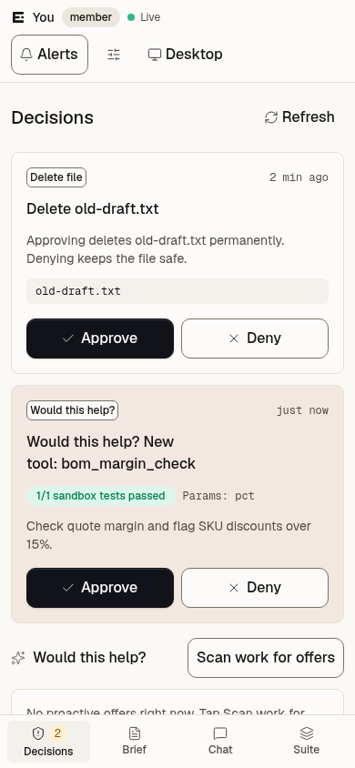
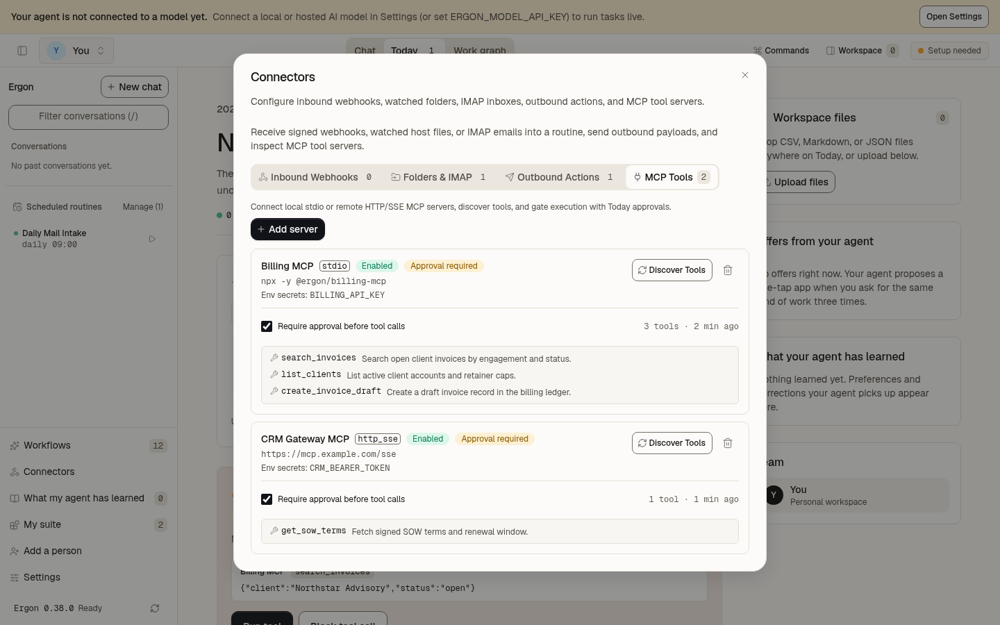
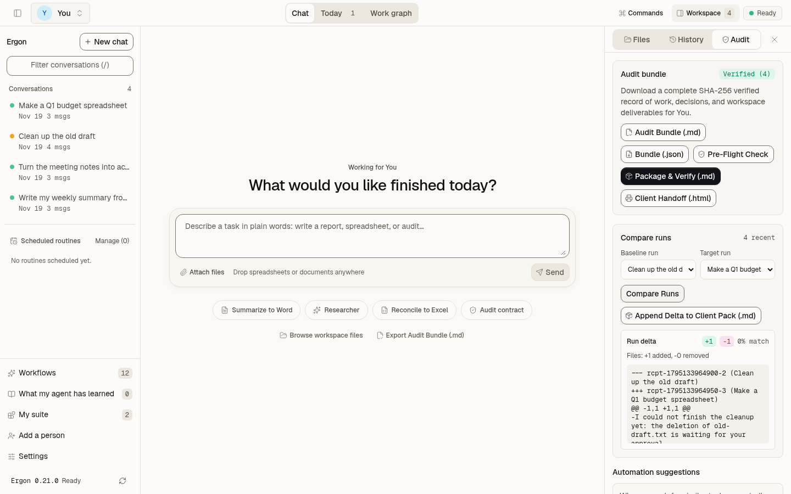
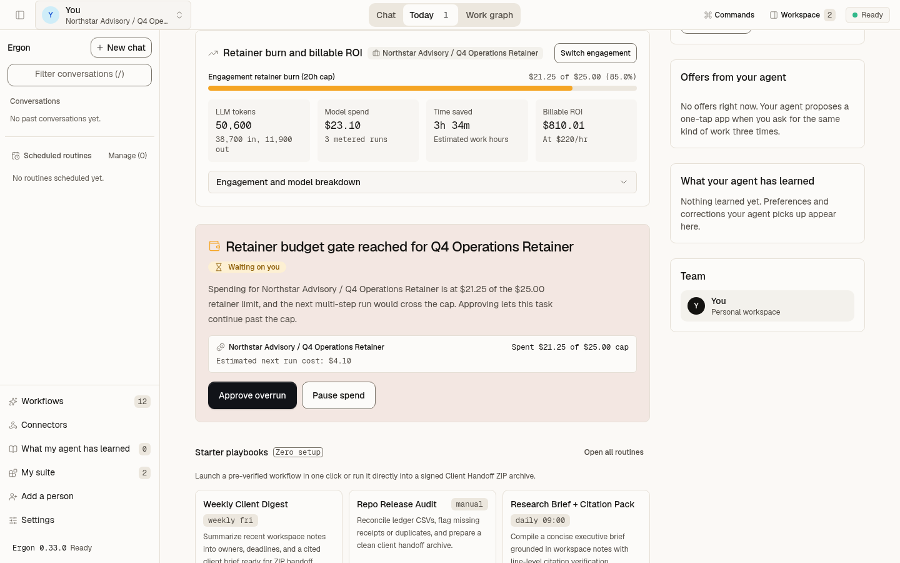

<div align="center">

<p>
  <picture>
    <source media="(prefers-color-scheme: dark)" srcset="docs/brand/ergon-logo-dark.svg" />
    
  </picture>
</p>

**A single-binary Rust + React workforce backend and agent desk for teams.**

Every employee gets an isolated workspace, phone-first Approve/Deny triage, sandboxed workflow & tool execution, and a shared company database backed by offline-verifiable SHA-256 receipts.

[](https://github.com/cayleb-james2008/ergon/actions/workflows/ci.yml)
[](https://github.com/cayleb-james2008/ergon/releases)
[](LICENSE)

[](https://cayleb-james2008.github.io/ergon/)

</div>

---

<p align="center">
  <picture>
    <source media="(prefers-color-scheme: dark)" srcset="docs/screenshots/hero-dark.png" />
    
  </picture>
  &nbsp;
  <picture>
    <source media="(prefers-color-scheme: dark)" srcset="docs/screenshots/phone-dark.png" />
    
  </picture>
</p>

<p align="center">
  <a href="https://github.com/cayleb-james2008/ergon/releases/download/v0.42.1/ergon-walkthrough.mp4">
    
  </a><br />
  <sub><a href="https://github.com/cayleb-james2008/ergon/releases/download/v0.42.1/ergon-walkthrough.mp4">Watch the 48-second walkthrough (1280×720 H.264 MP4)</a> · <a href="https://github.com/cayleb-james2008/ergon/releases/download/v0.42.1/ergon-walkthrough-chapters.vtt">Chapter markers (VTT)</a></sub>
</p>

## Why Ergon

Instead of wiring together a Node/Python server, Postgres, Redis, and background workers just to run internal agents safely, Ergon compiles into **one static binary** (`12.08 MiB` on Linux) serving desktop (`/`), mobile triage (`/phone`), crash-resumable DAG pipelines, encrypted secrets, and authenticated company APIs/MCP out of the box.

Routine analysis finishes autonomously — default **Simple mode** lets any employee talk to their computer in plain English and watch live step-by-step narration happen in real time, with 1-click switching to **Advanced mode** for DAG workflows, Work Graph, connectors, and schedules. Every workspace includes an **auto-updating 32-app baseline & Official MCP Registry library** with **proactive app recognition & 1-click setup recommendations** spanning **Google Workspace** (Gmail, Calendar, Drive, Docs, Sheets, Slides), **Microsoft 365 & Outlook** (Outlook Mail/Calendar, OneDrive/SharePoint, Teams, local Excel & Word/PDF), **Business Apps** (Slack, Notion, GitHub, CRM & Billing, Linear, Jira, Asana, Confluence, Figma, Zoom, HubSpot, Salesforce, Stripe, QuickBooks, Zendesk, Airtable, Shopify, Postgres & SQLite), and **On-Device Local** tools—plus live directory search, one-click browser OAuth2 (PKCE `S256`) sign-in, encrypted credential installs, and native Google Workspace / Microsoft Graph REST adapters alongside offline local execution. Consequential actions—deletes, outbound emails or webhooks, retainer budget caps, MCP calls, external plugin writes, and newly synthesized tools (`"Would this help?"`)—park as Approve/Deny cards on `/phone` and `/`.

---

## Key Capabilities

<table>
  <tr>
    <td width="50%">
      <strong>Shared Company DB, Memory &amp; Work Graph</strong><br />
      Per-employee isolated workspaces plus visibility-scoped company memory (<code>company</code>, <code>role:*</code>, <code>client:*</code>) and interactive team graph.<br /><br />
      <picture>
        <source media="(prefers-color-scheme: dark)" srcset="docs/screenshots/worktree-lanes-dark.png" />
        
      </picture>
    </td>
    <td width="50%">
      <strong>Tool Builder, Self-Improvement &amp; MCP / Mail</strong><br />
      Agents build and test sandboxed tools, gate new versions on historical case replay (with auto-rollback), and talk to MCP, SMTP/IMAP, and HMAC webhooks.<br /><br />
      <picture>
        <source media="(prefers-color-scheme: dark)" srcset="docs/screenshots/protocols-mcp-c4e2-dark.png" />
        
      </picture>
    </td>
  </tr>
  <tr>
    <td width="50%">
      <strong>Strict Client Vaults, Citations &amp; Audit Handoff</strong><br />
      Every claim is checked against workspace line ranges (<code>[file:L##]</code>). <code>Strict Client</code> blocks handoff exports on leaks or stale citations with <code>HTTP 409</code>.<br /><br />
      <picture>
        <source media="(prefers-color-scheme: dark)" srcset="docs/screenshots/run-diff-dark.png" />
        
      </picture>
    </td>
    <td width="50%">
      <strong>Retainer Metering, Rollups &amp; Offline Verify</strong><br />
      Live token spend, PDF/DOCX/XLSX generation, penny-exact <code>i128</code> table rollups, and offline bundle verification via <code>ergon verify</code>.<br /><br />
      <picture>
        <source media="(prefers-color-scheme: dark)" srcset="docs/screenshots/clients-metering-dark.png" />
        
      </picture>
    </td>
  </tr>
</table>

---

## Quick Start

Download a release archive for **Linux (`x86_64`)** or **Windows (`x86_64`)** from [Releases](https://github.com/cayleb-james2008/ergon/releases), or build from source (`Rust` + `Node.js 20+`):

```sh
# 1. Build (Linux / Windows)
cd frontend && npm ci && npm run build && cd ..
cargo build --release --locked

# 2. Run with Anthropic Claude (native /v1/messages + prompt caching)
ANTHROPIC_API_KEY=sk-ant-... ./target/release/ergon

# 3. Or OpenAI-compatible / local Ollama (:11434 auto-detected)
ERGON_MODEL_BASE_URL=https://api.openai.com/v1 ERGON_MODEL_ID=gpt-4.1 ERGON_MODEL_API_KEY=sk-... ./target/release/ergon
```

Also available right in your browser with zero install via the [GitHub Pages Live Demo](https://cayleb-james2008.github.io/ergon/) (runs the standalone offline engine in-browser).

---

## Reproducible Benchmarks & Security Evals

All claims below are backed by [`evals/run_evals.py`](evals/run_evals.py) against the compiled `v0.42.1` release binary ([`evals/results/report.md`](evals/results/report.md)) and live timing runs ([`evidence/timing/2026-11-27/`](evidence/timing/2026-11-27/README.md)):

| Evaluation | Mode | Baseline (Raw LLM) | Ergon (`v0.42.1`) | Outcome |
| --- | --- | --- | --- | --- |
| **1. 200-Row Messy Ledger Reconciliation** | `live_llm` (`claude-haiku-5-5`) | Exact (`18.69s`) | Exact **`$50,070.68`**, 4 dups flagged, `15` `[file:L##]` citations (`6.68s`, **2.8× faster**) | **PASS** |
| **2. 50-SKU Messy BOM Quote Builder** | `live_llm` (`claude-haiku-5-5`) | `47` SKUs, exact (`12.38s`) | **`47`** unique SKUs, exact **`$55,035.70`**, formula-escaped (`2.27s`, **5.5× faster**) | **PASS** |
| **3. Security & Prompt-Injection Probes** | `live_llm` + `deterministic` | — | **`8/8`** blocked (live injection, traversal, symlink, SSRF, secret write) | **PASS** |
| **4. Strict Client Leak Gate & Receipt Verify** | `deterministic` | — | **`HTTP 409`** on leak, **`HTTP 200`** clean ZIP, offline `ergon verify` valid | **PASS** |
| **5. Multi-Tenant RBAC & Memory Isolation** | `deterministic` | — | Role/workspace isolation enforced; unauthorized writes blocked (`403`) | **PASS** |
| **6. Replay-Gated Self-Improvement** | `deterministic` | — | `v2` promoted on replay (`0` regressions), `v3` rejected, live auto-rollback -> `v1` | **PASS** |

- **Server footprint (`v0.46.0` Linux release):** `12.08 MiB` single binary (`12,669,808 B`); `v0.40.0` measured `6.08 ms` cold boot, `22.19 MB` peak RSS, and `4,009.2 req/s` (`0/10,036` errors) over 16 concurrent workers.
- **Sequential live model timing study (`30` runs across 4 roles):** [`evidence/timing/2026-11-27/report.md`](evidence/timing/2026-11-27/report.md).

---

## Architecture & Security

Ergon separates probabilistic LLM routing from deterministic computation (`i128` cent arithmetic, 16-hop symlink confinement, SHA-256 receipt chains, and AES-256-GCM secret storage):

```text
  Desk (/) & Phone (/phone) ──► Raw TcpListener / rustls TLS (src/server/, src/auth.rs)
                                   │
        ┌──────────────────────────┼──────────────────────────┐
        ▼                          ▼                          ▼
  Agent Loop & Clients       DAG & Routine Engine      Company & Safety Core
  src/lib.rs, src/llm.rs     src/pipelines/,           src/company_db.rs, src/tool_builder.rs,
  (Anthropic /v1/messages,   src/scheduler.rs          src/self_improve.rs, src/tripwire.rs,
   OpenAI /v1/chat)          (4-way DAG, crash resume) src/receipts.rs, src/secret_store.rs
```

- **Deep dives:** [`ARCHITECTURE.md`](ARCHITECTURE.md) · [`SECURITY.md`](SECURITY.md) · [`docs/BACKEND_API.md`](docs/BACKEND_API.md) · [`evals/README.md`](evals/README.md) · [`CLAIMS.md`](CLAIMS.md) · [`MVP.md`](MVP.md) · [`CHANGELOG.md`](CHANGELOG.md)

## License

Released under the [MIT License](LICENSE).
