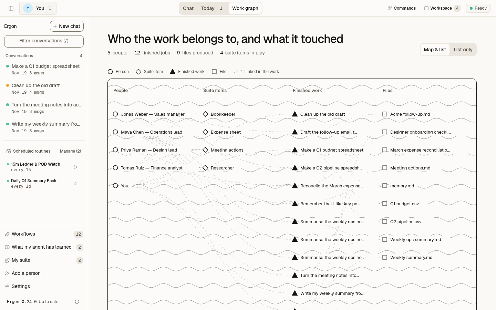
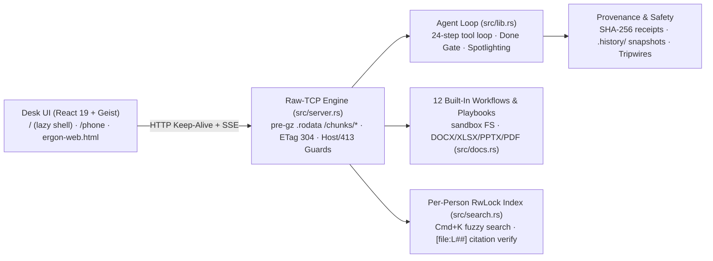

# Ergon

[](https://github.com/cayleb-james2008/ergon/actions)
[](https://github.com/cayleb-james2008/ergon/releases)
[](LICENSE)
[](#architecture)

<p align="center">
  <picture>
    <source media="(prefers-color-scheme: dark)" srcset="docs/screenshots/hero-dark.png" />
    
  </picture>
</p>

An AI agent desk for every employee — personal to each person, it learns how they work and **finishes digital work autonomously, end to end**. State a task in plain words; the agent executes against real sandboxed files and built-in workflows, grounds outputs with clickable `[file:L##]` source citations, and settles every completed run as a SHA-256 chained Field-Book receipt.

A single `8.48 MB` Rust binary serves the entire product: the lazy-split web desk (`/` and `/phone`), raw-TCP HTTP + SSE engine, sandboxed document tools, per-person standing memory, background routine scheduler, and `.history/` revision store. Zero external runtime or database server.

---

## Feature Gallery

<table>
  <tr>
    <td width="50%">
      <strong>Run Comparison &amp; Verified Delta Client Packs</strong><br />
      Compare any two finished receipts or <code>.history/</code> snapshots side-by-side and append a signed <code>## Verified Run Delta</code> section straight into your Client Pack (<code>.md</code>).
      <br /><br />
      <picture>
        <source media="(prefers-color-scheme: dark)" srcset="docs/screenshots/run-diff-dark.png" />
        
      </picture>
    </td>
    <td width="50%">
      <strong>Four-Band Work Graph &amp; Team Isolation</strong><br />
      Deterministic 1:1 SVG provenance map linking People, Suite items, Finished receipts, and Workspace deliverables with instant list toggle.
      <br /><br />
      <picture>
        <source media="(prefers-color-scheme: dark)" srcset="docs/screenshots/worktree-lanes-dark.png" />
        
      </picture>
    </td>
  </tr>
</table>

---

## Architecture



---

## Verified Benchmarks (`v0.24.0` vs `v0.11.0`)

Measured against the stripped fat-LTO release binary (`target/release/ergon`) on isolated local loopback (`16w` pinned `#154` profile) and a synthetic `5,000` receipts + `500` workspace files dataset:

| Metric | `v0.11.0` Baseline | `v0.24.0` Verified | Change |
| --- | --- | --- | --- |
| Release Binary Size | `16.0 MB` | **`8.48 MB`** (`8,893,280 B`) | **`-47.0%`** |
| Initial `/` Shell Payload | `1.15 MB` | **`153.8 KB` raw / `34.0 KiB` (`34,822 B`) gzip** (`15` `/chunks/*`) | **`-97.0%` wire** |
| Cold Boot to `200 OK` | — | **`10.92 ms`** | Instant startup |
| Peak RSS (`VmHWM`, `5k` receipts + `500` files, warm) | — | **`14.77 MB`** (`15,120 KB`) | Compact index + 32 KB scratch cap |
| Concurrent HTTP (`16w` mixed 5 routes across `5k`/`500`) | `724 req/s` (`188.7 ms` p95) | **`42,325.9 req/s`** keep-alive (`0.31 ms` p50, `0.84 ms` p95) · **`15,355.2 req/s`** cold (`0.92 ms` p50, `1.91 ms` p95, `0` err) | **`58.5x` keep-alive / `21.2x` cold** |
| Streaming Audit Bundle (`5k` entries) | — | **`21.08 ms`** | Zero-DOM streaming |
| Automated Verification | `204` Rust tests | **`222/222` Rust tests** · **`100/100` UI checks** · **`31/31` raw-TCP fuzz** · `0` `sloplint` fails | `0` warnings / `0` externals |

---

## Quick Start

### 1. Build from source

```sh
git clone https://github.com/cayleb-james2008/ergon.git
cd ergon
cd frontend && npm ci && npm run build && cd ..
CARGO_BUILD_JOBS=2 cargo build --release --locked
```

### 2. Launch locally

```sh
./target/release/ergon             # opens desktop app window on http://127.0.0.1:8787
./target/release/ergon --no-open   # headless local server mode
```

Or install as a managed local launcher (`ergon-serve`) with optional `systemd --user` unit:

```sh
./install.sh [--prefix DIR] [--data DIR] [--no-service]
```

### 3. Connect a model (automatic or live in Settings)

On startup (unless `ERGON_NO_AUTO_MODEL=1` or an explicit `ERGON_MODEL_BASE_URL` / `ERGON_MODEL_API_KEY` / `data/config.json` is set), Ergon automatically probes running local OpenAI-compatible gateways on loopback (`127.0.0.1:11434/v1`, `:8790/v1`, `:8789/v1`) with no API key required. You can switch providers or enter a remote endpoint and API key live inside **Settings** (`GET/POST /api/config`). Without a reachable gateway or key, `/api/chat` refuses cleanly (`HTTP 503`) rather than fabricating an answer.

---

## Configuration (`env`)

| Var | Default |
| --- | --- |
| `ERGON_HOST` / `ERGON_PORT` | `127.0.0.1` / `8787` |
| `ERGON_ALLOWED_HOSTS` | — (comma-separated extra host names accepted without a gate token, e.g. a LAN name for `/phone`; loopback is always accepted) |
| `ERGON_DATA_DIR` | `./data` (people, threads, `config.json`, per-person workspaces) |
| `ERGON_WORKSPACE` | `<data>/workspace` (default person's sandbox root) |
| `ERGON_MODEL_BASE_URL` | auto-probed local gateway (`:11434` / `:8790` / `:8789`), else `https://opencode.ai/zen/go/v1` |
| `ERGON_MODEL_ID` | auto-detected gateway default, else `deepseek-v4.1-flash` |
| `ERGON_MODEL_API_KEY` | — (optional on loopback; required for remote endpoints) |
| `ERGON_NO_AUTO_MODEL` | `0` (`1` disables startup local gateway auto-probing) |
| `ERGON_NO_OPEN` / `ERGON_OPEN` | `0` (`ERGON_NO_OPEN=1` or `--no-open` disables desktop window launch; `--app` forces it) |
| `ERGON_GATE_TOKEN` | — (when set, every request must carry matching `X-Ergon-Gate` header) |
| `ERGON_FETCH_ALLOW_PRIVATE` | `0` (`1` lets the agent open loopback/private-network URLs without asking) |
| `ERGON_FETCH_ALLOW_HOSTS` | — (comma-separated private hosts the agent may always open) |
| `ERGON_TRIPWIRE_NO_BAN` | `0` (`1` records scanner trips without IP banning) |
| `ERGON_TRUST_PROXY` | `0` (`1` trusts right-most `X-Forwarded-For` behind a local reverse proxy) |

---

## Core Capabilities

- **Desk Shell & Command Palette (`Cmd/Ctrl+K`)** — Lazy-split `assets/index.html` served over `/` and `/phone` with pre-compressed `.rodata` `/chunks/*`, `Vary: Accept-Encoding`, strong `ETag` + `304 Not Modified`, self-hosted **Geist** & **Geist Mono**, light-first tokens with Settings-only Light/Dark switch, collapsible right **Workspace** inspector (`Files`, `History`, `Audit`), and scored fuzzy `Cmd/Ctrl+K` jump across workspace files, `[file:L##]` citations, playbooks, workflows, and receipts.
- **Multi-Run Retainer Summary Packs, Batch Citation Freshness Gate & Client Handoff (`.html` / `.md`)** — From **Today → Finished**, export a 1-click **Client Summary Pack** (`.md` or printable CSP-locked `.html`) with a live `#summary-citation-gate` freshness badge. `GET /api/files/pack?summary=1` (`preflight=1&summary=1`) verifies `[file:L##]` citations and workspace deliverable SHA-256 digests across all summarized finished runs in one batch pass (`X-Ergon-Pack-Summary-Runs`, `X-Ergon-Pack-Summary-Citations`, `X-Ergon-Pack-Summary-Stale`), annotating any drifted lines against `.history/` snapshots automatically. Inside **Inspector → Audit** and **History Diff**, `GET /api/receipts/compare` and `GET /api/files/pack?delta_a=...&delta_b=...` compute exact line/file deltas.
- **Standalone Web Demo (`npm run build:web`)** — Builds `frontend/dist/ergon-web.html` backed by an offline in-browser workflow & file engine (`webEngine.ts`) with zero external network requests.
- **Learned Memory Health & Stale-Reference Guard (`GET /api/memory/health`, `POST /api/memory/heal`)** — Audits per-person `memory.md` standing rules for contradicting directives, duplicate preferences, and broken `[file:L##]` or sandboxed workspace file references, surfacing **Healthy / N Issues** pills and 1-click **Resolve & Prune** across the desk rail, Today card, and **What my agent has learned** modal (`webEngine.ts` parity preserved).
- **Workspace File Viewer, History, Routine Catch-Up & Signed Playbook Packs** — Real CSV table sorting/filtering, Markdown section jump, collapsible JSON tree, `.history/` side-by-side diffs with reversible restore, multi-step sequential **Workspace Playbooks** (`POST /api/routines/:id/run`), **Scheduled Routine Catch-Up & SHA-256 Receipt Verification** (`missed_windows` overdue cadence detection, 1-click `POST /api/routines/:id/catchup` & `POST /api/scheduler/catchup`, and `Verified`/`Drift` receipt-chain pills), 1-click deterministic **Dry-Run Preview** (`POST /api/playbooks/:id/preview`) with ordered step inference, expected file-impact paths, and a **`Reversible via .history/`** safety badge, plus portable `.ergon-playbook.json` export & import (`GET /api/playbooks/:id/export`, `POST /api/playbooks/import`) enforced by strict `ergon-playbook-v1` schema validation, `<= 256 KB` payload cap, and canonical SHA-256 checksums.
- **Office & PDF Documents (`src/docs.rs`)** — Reads PDFs (including modern CID fonts), Word `.docx`, Excel `.xlsx` (`book.xlsx#Sheet2`), and PowerPoint `.pptx` (slides + notes), and exports Markdown to styled `.docx` and CSV to typed `.xlsx` (`POST /api/files/export`). Uploads travel byte-exact up to `25 MB` behind zip-bomb and PDF timeout guards.
- **CWE-22 / CWE-59 Sandbox & OWASP Tripwires (`src/tripwire.rs`)** — Component-walking path confinement (16-hop symlink cap, symlink-as-object moves, traversal/sibling-prefix refusal), honeytrap endpoints (`/.env`, `/.git/config`, `/wp-login.php`), traceable bait keys (`sk-ergon-…`), Spotlighting boundaries on tool output, outbound secret-exfiltration guards, and tamper-evident `security_events.json` logging.
- **Honesty Machinery** — Completion claims are verified against actual workspace writes (`check_mentions`), oversized payloads return `HTTP 413` promptly with the client write half kept open, oversized headers return `431`, cross-site/non-JSON writes and DNS-rebinding `Host` headers are rejected, and corrupt JSON stores auto-backup to `.bak`.

---

## Verification

```sh
CARGO_BUILD_JOBS=2 cargo clippy --all-targets -- -D warnings
CARGO_BUILD_JOBS=2 cargo test          # 222 Rust unit, E2E, scale, scheduler/history, workflow, tripwire & document tests
cargo xwin check --target x86_64-pc-windows-msvc
cd frontend && npm run check:ui        # Playwright E2E gate (74/74), Work Graph probe (6/6), worst-case replay (20/20)
```

---

## Versions & Updates

**Releasing:** bump `version` in `Cargo.toml` and `frontend/package.json`, add a `## X.Y.Z - YYYY-MM-DD` entry to `CHANGELOG.md`, and merge to `main`. `.github/workflows/release.yml` builds Linux (`x86_64`, `aarch64`), macOS (`aarch64`), and Windows (`x86_64`) binaries and publishes GitHub Release `vX.Y.Z` with `SHA256SUMS`.

Self-update (`src/update.rs`) checks GitHub Releases, verifies `SHA-256` and `--version`, and swaps binaries strictly from loopback on released builds (`ERGON_UPDATE_MODE=notify|auto|off`, `ERGON_UPDATE_REPO`, `ERGON_UPDATE_API`).
