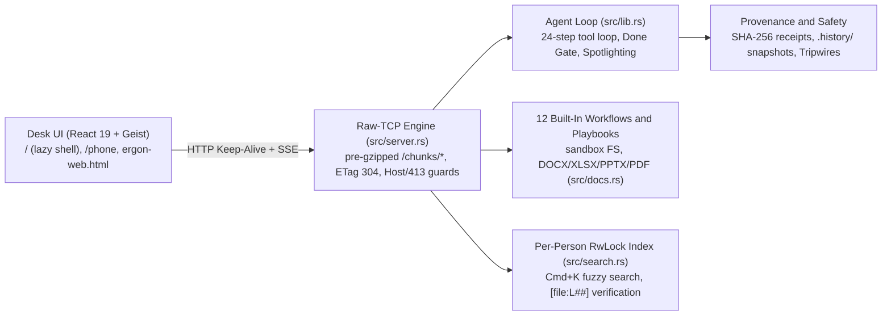

# Ergon

[](https://github.com/cayleb-james2008/ergon/actions)
[](https://github.com/cayleb-james2008/ergon/releases)
[](LICENSE)
[](#architecture)

<p align="center">
  <picture>
    <source media="(prefers-color-scheme: dark)" srcset="docs/screenshots/hero-dark.png" />
    
  </picture>
</p>

Ergon is a local agent desk for individual employees. Describe a task in plain words, and the agent works against files inside a per-person workspace using built-in workflows, verifies citations against exact line numbers (`[file:L##]`), and records each finished run as a SHA-256 chained Field-Book receipt.

One Rust binary serves the React web UI (`/` and `/phone`), the raw-TCP HTTP and SSE engine, sandboxed document readers and exporters, standing memory (`memory.md`), the routine scheduler, and the `.history/` snapshot store without an external database or runtime.

---

## Feature gallery

<table>
  <tr>
    <td width="50%">
      Compare any two finished receipts or <code>.history/</code> snapshots side by side, switch workspace audit policy profiles in one click, and append a signed <code>## Verified Run Delta</code> section into a Client Pack.
      <br /><br />
      <picture>
        <source media="(prefers-color-scheme: dark)" srcset="docs/screenshots/run-diff-dark.png" />
        
      </picture>
    </td>
    <td width="50%">
      Inspect a deterministic SVG provenance graph connecting people, playbooks, finished receipts, and workspace deliverables, or toggle back to a plain list view.
      <br /><br />
      <picture>
        <source media="(prefers-color-scheme: dark)" srcset="docs/screenshots/worktree-lanes-dark.png" />
        
      </picture>
    </td>
  </tr>
</table>

---

## Architecture



---

## Verified benchmarks (`v0.27.0` vs `v0.11.0`)

Measured against the stripped fat-LTO release binary on local loopback against a `5,000` receipts and `500` workspace files dataset:

| Metric | `v0.11.0` baseline | `v0.27.0` measured | Change |
| --- | --- | --- | --- |
| Release binary size | `16.0 MB` | `7.497 MB` (`7,861,088 B`) | `-53.1%` |
| Initial `/` shell payload | `1.15 MB` | `150.4 KB` raw / `34.0 KiB` (`34,857 B`) gzip (`15` `/chunks/*`) | `-97.0%` wire |
| Cold boot to `200 OK` | `n/a` | `3.00 ms` median (`2.85 ms` min) | Under `5 ms` target |
| Peak RSS (`VmHWM`, `5k` receipts + `500` files, warm + audit bundle) | `n/a` | `15.31 MB` (`15,680 KB`) | `M_ARENA_MAX=1` + 2 warm workers |
| Concurrent HTTP (`16w` mixed 5 routes across `5k`/`500`) | `724 req/s` (`188.7 ms` p95) | `47,967.8 req/s` keep-alive (`0.26 ms` p50, `0.76 ms` p95) / `16,750.3 req/s` cold (`0.72 ms` p50, `1.67 ms` p95, `0` err) | `66.3x` keep-alive / `23.1x` cold |
| Streaming audit bundle (`5k` entries) | `n/a` | `55.65 ms` (`1,936,272 B`) | Single-allocation JSON |
| Automated checks | `204` Rust tests | `228/228` Rust tests, `100/100` UI checks, `47/47` CLI/policy/handoff fuzz, `0` `sloplint` fails | Zero warnings / zero externals |

---

## Quick start

### 1. Build from source

```sh
git clone https://github.com/cayleb-james2008/ergon.git
cd ergon
cd frontend && npm ci && npm run build && cd ..
CARGO_BUILD_JOBS=2 cargo build --release --locked
```

### 2. Launch locally

```sh
./target/release/ergon             # opens a desktop window on http://127.0.0.1:8787
./target/release/ergon --no-open   # runs in headless server mode
./target/release/ergon verify ergon-audit-bundle.json --workspace ./data/workspace
./target/release/ergon export-handoff --out ergon-client-handoff.zip
```

To install a managed local launcher (`ergon-serve`) with an optional `systemd --user` service:

```sh
./install.sh [--prefix DIR] [--data DIR] [--no-service]
```

### 3. Connect a model

On startup, unless `ERGON_NO_AUTO_MODEL=1` or an explicit `ERGON_MODEL_BASE_URL`, `ERGON_MODEL_API_KEY`, or `data/config.json` is set, Ergon probes OpenAI-compatible gateways on loopback (`127.0.0.1:11434/v1`, `:8790/v1`, `:8789/v1`). You can switch providers or enter a remote endpoint and key inside Settings (`GET` and `POST /api/config`). Without a reachable gateway or key, `/api/chat` returns `HTTP 503` instead of making up a response.

---

## Configuration (`env`)

| Variable | Default |
| --- | --- |
| `ERGON_HOST` / `ERGON_PORT` | `127.0.0.1` / `8787` |
| `ERGON_ALLOWED_HOSTS` | unset (comma-separated extra hosts accepted without a gate token; loopback is always accepted) |
| `ERGON_DATA_DIR` | `./data` (people, threads, `config.json`, per-person workspaces) |
| `ERGON_WORKSPACE` | `<data>/workspace` (default person sandbox root) |
| `ERGON_MODEL_BASE_URL` | auto-probed local gateway (`:11434`, `:8790`, or `:8789`), or `https://opencode.ai/zen/go/v1` |
| `ERGON_MODEL_ID` | auto-detected gateway default, or `deepseek-v4.1-flash` |
| `ERGON_MODEL_API_KEY` | unset (optional on loopback; required for remote endpoints) |
| `ERGON_NO_AUTO_MODEL` | `0` (`1` disables local gateway probing on startup) |
| `ERGON_NO_OPEN` / `ERGON_OPEN` | `0` (`ERGON_NO_OPEN=1` or `--no-open` disables window launch; `--app` forces it) |
| `ERGON_GATE_TOKEN` | unset (when set, every request must send a matching `X-Ergon-Gate` header) |
| `ERGON_FETCH_ALLOW_PRIVATE` | `0` (`1` lets the agent fetch loopback or private-network URLs without asking) |
| `ERGON_FETCH_ALLOW_HOSTS` | unset (comma-separated private hosts the agent may always fetch) |
| `ERGON_TRIPWIRE_NO_BAN` | `0` (`1` logs scanner trips without banning the source IP) |
| `ERGON_TRUST_PROXY` | `0` (`1` trusts the right-most `X-Forwarded-For` entry behind a local reverse proxy) |

---

## Core capabilities

### Client handoff bundle and leak pre-check

Run `ergon export-handoff`, call `POST /api/export/handoff`, or use **Client handoff** in the Audit tab of the right inspector to scan deliverables and package `CLIENT_SUMMARY.md`, `audit_bundle.json`, `VERIFY.txt`, and `SHA256SUMS` into a client-ready ZIP archive. Under `Strict Client`, host machine paths, exposed keys, `.env` assignments, and SSN patterns block export with exact `file:L##` fix hints until cleaned or explicitly overridden (`--force`).

### Offline evidence verification

`ergon verify <bundle-or-pack> [--workspace <dir>] [--json]`, `POST /api/verify/evidence`, and the Verify evidence card in the Audit tab verify exported audit bundles (`.json`), client deliverable packs (`.md`), and signed playbook packs (`.ergon-playbook.json`) against SHA-256 digests and Field-Book receipt chains without starting a server or model endpoint.

### Workspace audit policy profiles

Switch between `Fast Internal`, `Strict Client`, and `Air-Gapped` from the Audit tab in the right inspector (`GET`, `PUT`, and `POST /api/workspace/policy`). Under `Strict Client`, `GET /api/files/pack` returns `409 Conflict` when exports reference stale or missing `[file:L##]` citations, and host home or temp paths inside packs and audit bundles redact to `~/`. Under `Air-Gapped`, `fetch_url`, `research`, and `host_fetch_url` are blocked.

### Desk shell and command palette

The lazy-split UI serves `/` and `/phone` with pre-compressed `/chunks/*` assets, `Vary: Accept-Encoding`, `ETag` with `304 Not Modified`, self-hosted Geist fonts, a Settings-only Light and Dark toggle, a collapsible right inspector (`Files`, `History`, `Audit`), and `Cmd/Ctrl+K` fuzzy search across workspace files, citations, playbooks, workflows, and receipts.

### Retainer summary packs and delta comparison

From Today, export a multi-run summary pack (`.md` or printable `.html`) with a live `#summary-citation-gate` status badge. `GET /api/files/pack?summary=1` checks `[file:L##]` citations and deliverable SHA-256 hashes across summarized runs in one pass and flags drifted lines against `.history/` snapshots. Inside Audit and History Diff, `GET /api/receipts/compare` and `GET /api/files/pack?delta_a=...&delta_b=...` compute line and file differences.

### Standalone offline demo

`npm run build:web` compiles `frontend/dist/ergon-web.html`, an in-browser desk backed by `webEngine.ts` that runs workflows, policy profiles, memory checks, and pack exports locally without network calls.

### Memory health checks

`GET /api/memory/health` and `POST /api/memory/heal` inspect `memory.md` for duplicate preferences, conflicting rules, and broken `[file:L##]` or workspace path references, surfacing `Healthy` or issue-count badges with one-click pruning.

### Files, history, playbooks, and routine catch-up

The file viewer supports sortable CSV tables, Markdown section links, a collapsible JSON tree, `.history/` side-by-side diffs with restore, sequential playbooks (`POST /api/routines/:id/run`), routine catch-up (`POST /api/routines/:id/catchup` and `POST /api/scheduler/catchup`) with SHA-256 `Verified` and `Drift` pills, read-only dry-run previews (`POST /api/playbooks/:id/preview`), and schema-validated `.ergon-playbook.json` import and export up to `256 KB`.

### Office and PDF documents

`src/docs.rs` reads PDF, `.docx`, `.xlsx` (`book.xlsx#Sheet2`), and `.pptx` files and exports Markdown to `.docx` or CSV to `.xlsx` via `POST /api/files/export`. Uploads allow up to `25 MB` behind zip-bomb and PDF timeout limits.

### Sandbox and request safety

Path confinement (`src/tripwire.rs`) walks components with a 16-hop symlink limit and rejects traversal or sibling-prefix escapes. Built-in guards cover honeytrap paths (`/.env`, `/.git/config`, `/wp-login.php`), traceable bait keys (`sk-ergon-...`), Spotlighting boundaries on tool output, `413` oversized-body and `431` oversized-header caps, cross-site write checks, DNS-rebinding `Host` checks, and `.bak` auto-backups on corrupt JSON stores.

---

## Verification

```sh
CARGO_BUILD_JOBS=2 cargo clippy --all-targets -- -D warnings
CARGO_BUILD_JOBS=2 cargo test
cargo xwin check --target x86_64-pc-windows-msvc
cd frontend && npm run check:ui
```

---

## Releases and updates

To publish a release, bump `version` in `Cargo.toml` and `frontend/package.json`, add a `## X.Y.Z - YYYY-MM-DD` section in `CHANGELOG.md`, and merge to `main`. `.github/workflows/release.yml` compiles Linux (`x86_64`, `aarch64`), macOS (`aarch64`), and Windows (`x86_64`) binaries and publishes `vX.Y.Z` with `SHA256SUMS`.

Self-update (`src/update.rs`) checks GitHub Releases, verifies SHA-256 digests and `--version`, and swaps binaries from loopback (`ERGON_UPDATE_MODE=notify|auto|off`, `ERGON_UPDATE_REPO`, `ERGON_UPDATE_API`).
